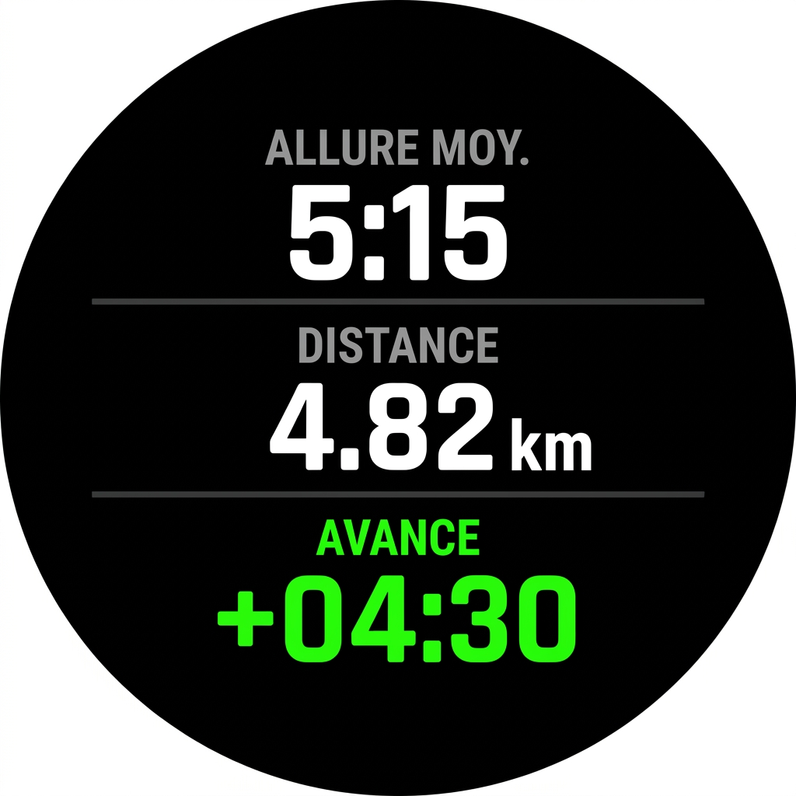
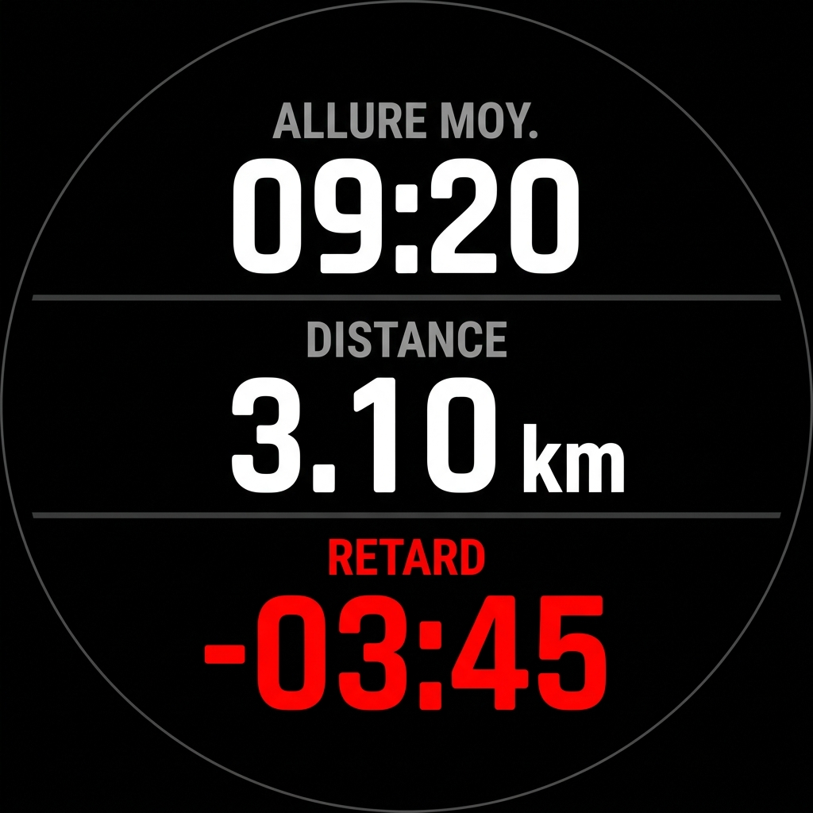
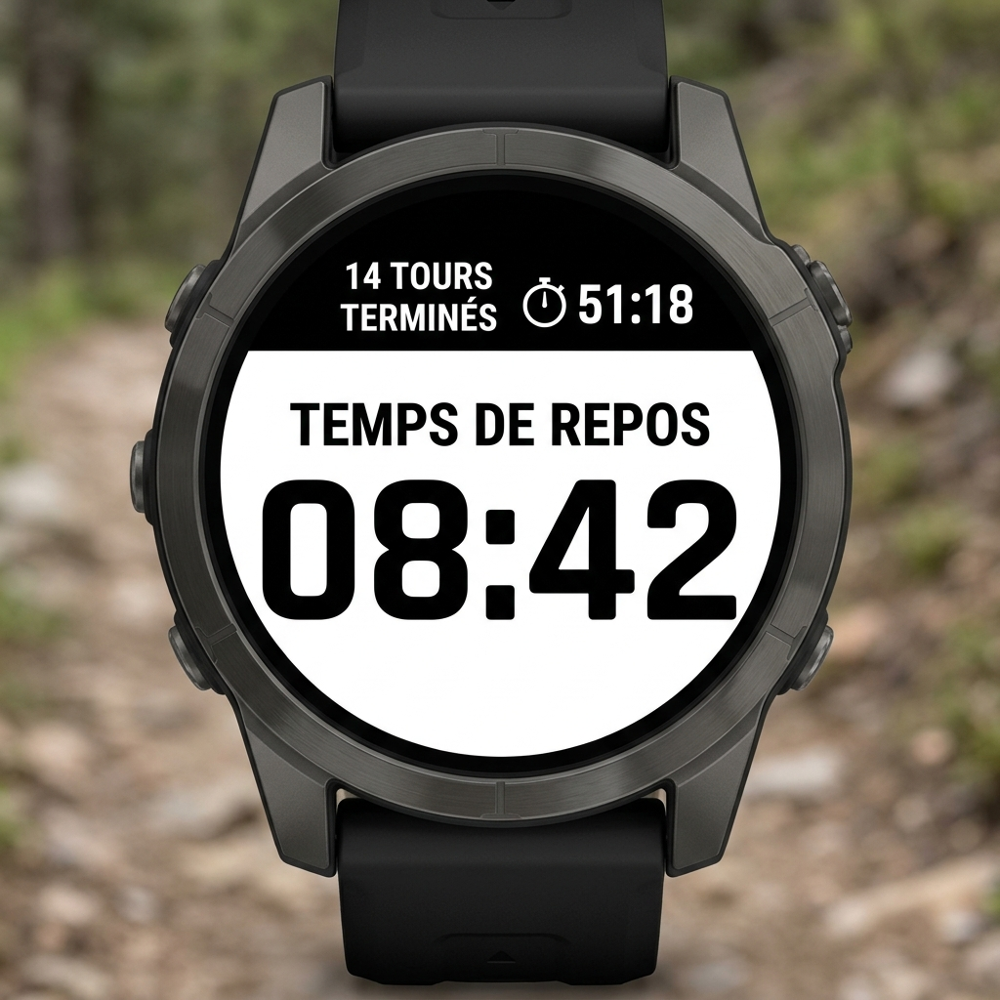
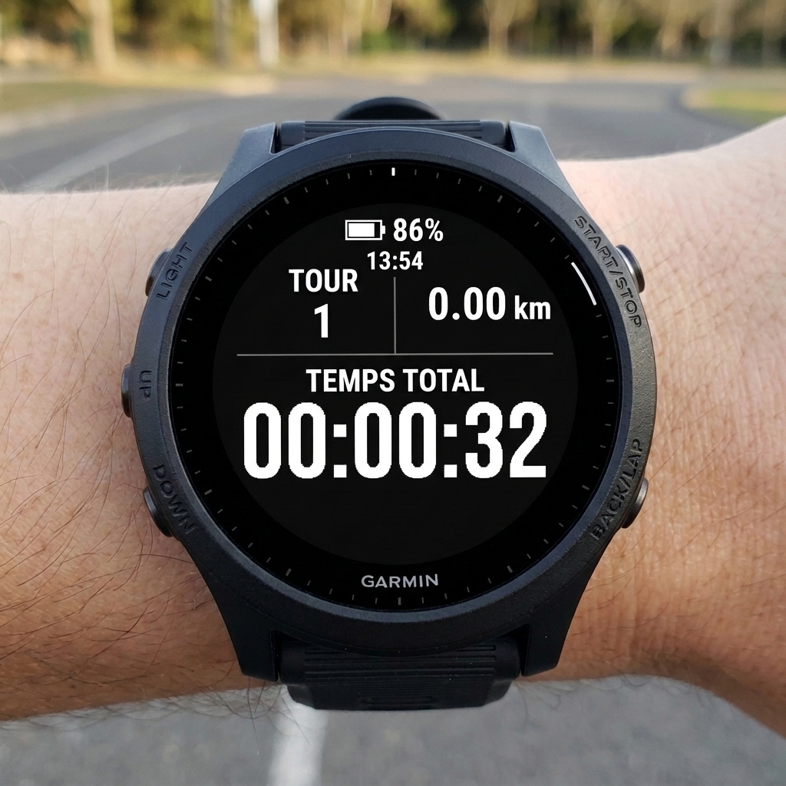
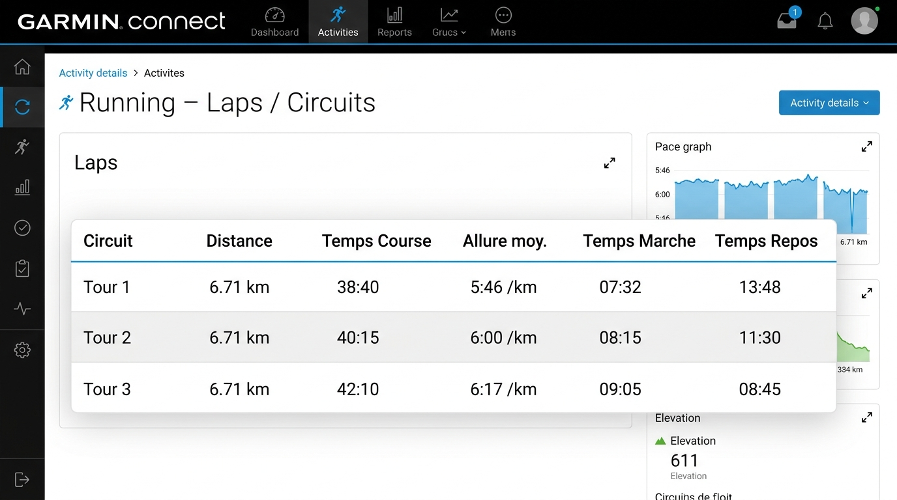

# Garmin Backyard Ultra App (v1.0.0)

Application autonome (**Watch-App**) Connect IQ pour montres Garmin, spécialement conçue pour les épreuves de **Backyard Ultra** (boucle de 6,706 km à parcourir en moins d'une heure, avec départ toutes les heures).

Lien du dépôt : [https://github.com/Cynewulf89/garmin-app-backyard](https://github.com/Cynewulf89/garmin-app-backyard)

---

## 📱 Aperçu des Écrans

| Écran 1 (En Avance) | Écran 1 (En Retard) | Écran 1 (Repos / Terminé) | Écran 2 (Stats & Batterie) |
| :---: | :---: | :---: | :---: |
|  |  |  |  |

---

## ⚙️ Contrôles des Boutons & Enregistrement

- **Bouton START / STOP** : Démarre l'épreuve. Un nouvel appui met en pause l'activité et ouvre le menu natif pour **Reprendre**, **Enregistrer** ou **Ignorer**.
- **Boutons UP / DOWN** : Basculent entre l'**Écran 1** (gestion de la boucle) et l'**Écran 2** (statistiques globales).
- **Bouton BACK** : Met en pause et ouvre également le menu de clôture d'activité si une session est active.


### Écran 1 : Gestion de la Boucle (Mode Course)

- **ALLURE MOY.** : Allure moyenne calculée sur la boucle en cours (min/km).
- **DISTANCE** : Kilométrage parcouru sur la boucle actuelle (0 à 6,71 km).
- **AVANCE / RETARD (Delta)** :
  - **Vert (+)** si vous êtes en avance sur l'allure cible pour finir la boucle en moins de 60 minutes.
  - **Rouge (-)** si vous êtes en retard.
- **Réinitialisation automatique** : Cet écran se remet à zéro automatiquement à chaque heure pile.

### Écran de Pause automatique (Dès 6,706 km atteints)

- **Déclenchement automatique** : Dès que les 6,706 km du tour sont complétés, l'enregistrement GPS est automatiquement mis en pause pour éviter d'enregistrer des distances parasites au ravitaillement.
- **Quart supérieur (1/4 - fond noir)** :
  - Nombre de tours complétés : **X TOURS TERMINÉS** .
  - Temps du tour tout juste achevé : Icône chronomètre ⏱️ et temps (**MM:SS**).
- **Trois quarts inférieurs (3/4 - fond blanc)** :
  - Libellé **TEMPS DE REPOS** en noir.
  - Décompte géant en noir (**MM:SS**) du temps de repos restant avant le coup d'envoi de l'heure suivante.
- **Alarme unique (Vibration)** : Une vibration distincte retentit automatiquement **1 minute** avant le départ du prochain tour (à 01:00 restante au repos).
- **Reprise automatique** : À l'heure pile suivante, l'enregistrement GPS reprend automatiquement et l'écran repasse sur le mode course normal.

### Écran 2 : Statistiques Globales & Autonomie

- **En-tête** :
  - **Batterie** : Icône et pourcentage restant affichés tout en haut.
  - **Heure actuelle** : Affichage discret (**HH:MM**) sous la batterie.
- **Milieu** :
  - **TOUR** : Numéro du tour actuel (1, 2, 3...).
  - **TOTAL KM** : Kilométrage total cumulé depuis le départ de l'épreuve.
- **Bas de l'écran** :
  - **TEMPS TOTAL** : Grand chronomètre complet (**HH:MM:SS**) affiché en chiffres géants (`FONT_NUMBER_HOT`) pour une lisibilité maximale en course.

---

## 📊 Rendu dans Garmin Connect (Analyse des Circuits)

Grâce aux champs personnalisés Connect IQ (**FitContributor**), chaque tour de 60 minutes est automatiquement enrichi dans le tableau des circuits de l'application et du site web Garmin Connect :



- **Temps Course** : Temps effectif passé à courir (cadence ≥ 145 spm).
- **Temps Marche** : Temps passé à marcher pendant la boucle (cadence < 145 spm).
- **Temps Repos** : Temps passé au repos au ravitaillement avant le départ de l'heure suivante.

---

## 🚀 Installation

### Prérequis

- Une montre Garmin compatible : **Forerunner 945**, **Fenix 6**, **Enduro**, ou **Epix Pro (51mm)**.
- [Garmin Express](https://www.garmin.com/express/) sur ordinateur ou smartphone avec Garmin Connect.

### Méthode 1 : Fichier `.prg` direct (Recommandé)

1. Téléchargez le fichier correspondant à votre modèle (ex : `backyard-fr945.prg` pour Forerunner 945) depuis les [Releases](https://github.com/Cynewulf89/garmin-app-backyard/releases).
2. Connectez la montre en USB à votre PC.
3. Copiez le fichier dans le dossier `/GARMIN/APPS/` de la montre en le renommant `backyard.prg`.
4. Éjectez l'appareil en toute sécurité puis redémarrez la montre.
5. L'application **Backyard Ultra** apparaît dans votre liste d'activités (ou sous "Ajouter" tout en bas).

### Méthode 2 : Compilation via VS Code (Développeurs)

1. Clonez le dépôt :

   ```bash
   git clone https://github.com/Cynewulf89/garmin-app-backyard.git
   ```

2. Ouvrez le dossier dans VS Code.
3. Exécutez la commande `Monkey C: Build Current Project` (`Ctrl+Shift+P`).
4. Branchez votre montre en USB et copiez le fichier `.prg` compilé dans le dossier `GARMIN/APPS/` de l'appareil.
